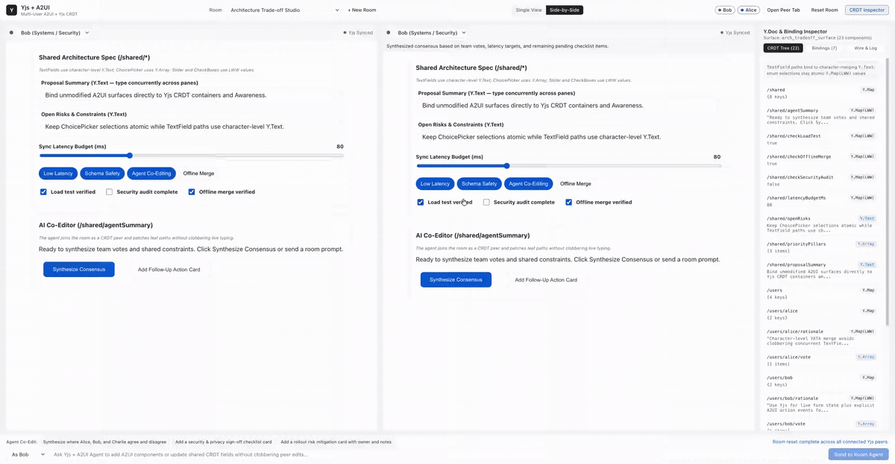
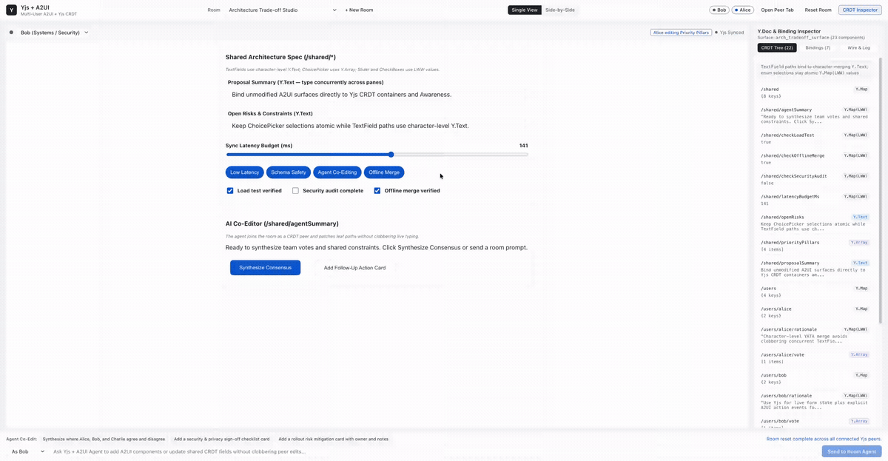

# Multi-User A2UI + Yjs CRDT Collaboration

An experimental prototype exploring multi-user [A2UI](https://a2ui.org/) surfaces by binding an unmodified `@a2ui/angular` BasicCatalog surface bidirectionally to [Yjs](https://yjs.dev/) (`Y.Doc` + `y-protocols/awareness`) and a Go [`ygo`](https://github.com/reearth/ygo) WebSocket server.

## Overview

Stock A2UI assumes a 1:1 `Agent <-> Renderer` loop. This experiment binds `@a2ui/angular`'s `SurfaceGroupModel`, `SurfaceModel`, and `DataModel` to a shared Yjs CRDT room so multiple browser peers and an AI agent can co-edit the same A2UI surface concurrently:

- **Surface & Component Tree Sync**: `doc.getMap('meta')`, `doc.getMap('components')`, and `doc.getArray('componentOrder')` synchronize `createSurface` and live `updateComponents` mutations across peers.
- **Schema-Aware CRDT Data Model (`doc.getMap('data')`)**:
  - `TextField.value` paths use character-level `Y.Text` with minimal UTF-16 diffing and relative-position caret preservation.
  - Multi-value selections (`ChoicePicker`) use `Y.Array`.
  - Numeric/boolean fields (`Slider`, `CheckBox`) use LWW values inside nested `Y.Map`s.
- **Scoped DataModel Namespaces**:
  - `/shared/...`: Shared collaborative state synced across all peers.
  - `/me/...`: Bidirectionally aliased per peer to `/users/<actorId>/...` in `Y.Doc`, while `/users/*` remains readable for team tallies.
  - `/local/...`: Client-only viewport state kept purely in the local `DataModel`.
- **Presence & AI Co-Editing**: `y-protocols/awareness` tracks peer presence and field focus, while the Go backend agent joins the room as a native CRDT peer and applies granular leaf `updateDataModel` and `updateComponents` mutations without clobbering concurrent human typing.

## Demos

> Note: This sample is an experimental prototype demo and is not intended for production use.

### Single-User Side-by-Side Demo



### Multi-User Demo



## Prerequisites

- **Go** 1.25+ (or **Bazel** 8+ via Bzlmod)
- **Node.js** 22.22.3+ and **pnpm** (via `corepack`)
- **Optional**: `GEMINI_API_KEY` environment variable to enable live Gemini co-editing via `google.golang.org/genai` (defaults to `gemini-flash-latest`; override with `GEMINI_MODEL`). Multi-user Yjs sync works without an API key; agent prompts/actions require `GEMINI_API_KEY` and return an error without mutating the surface when unavailable.

> Note: Optional use of the Gemini API is subject to the [Gemini API Additional Terms of Service](https://ai.google.dev/gemini-api/terms).

## Running the Sample

### 1. Build the Angular Frontend

```bash
cd web
corepack pnpm install --frozen-lockfile
corepack pnpm run build
cd ..
```

### 2. Run the Go Backend

```bash
# Optional: export GEMINI_API_KEY="your-key"
go run . --port=8890
```

Or with Bazel:

```bash
bazel run //:yjs-a2ui -- --port=8890 --web_dir="$PWD/web/dist/browser"
```

Open http://localhost:8890 in your browser to collaborate in either mode:

1. **Multi-window / multi-user**: Share the server URL (or switch to **Single View** / click **Open Peer Tab**) so each participant connects from their own browser window.
2. **Side-by-side**: Use **Side-by-Side** to try a live 2-peer connection in a single window.

## Running Tests

### Go Backend Tests

```bash
go test ./...
# or with Bazel:
bazel test //...
```

### Frontend Binder Tests

```bash
cd web
corepack pnpm test
```
